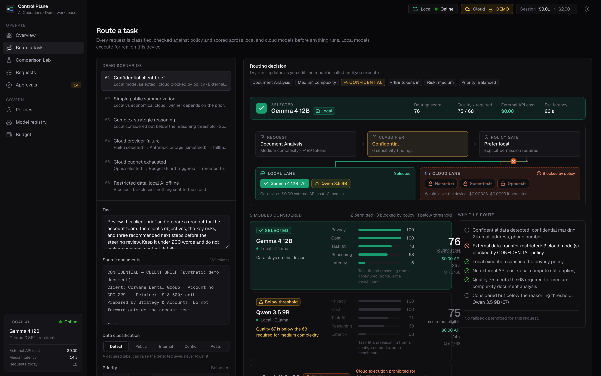
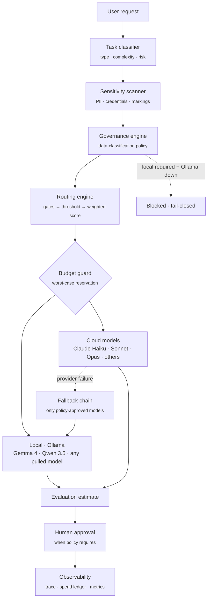
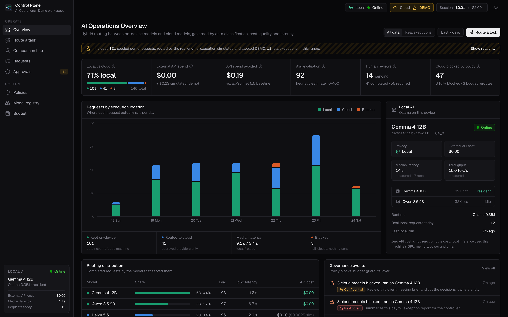
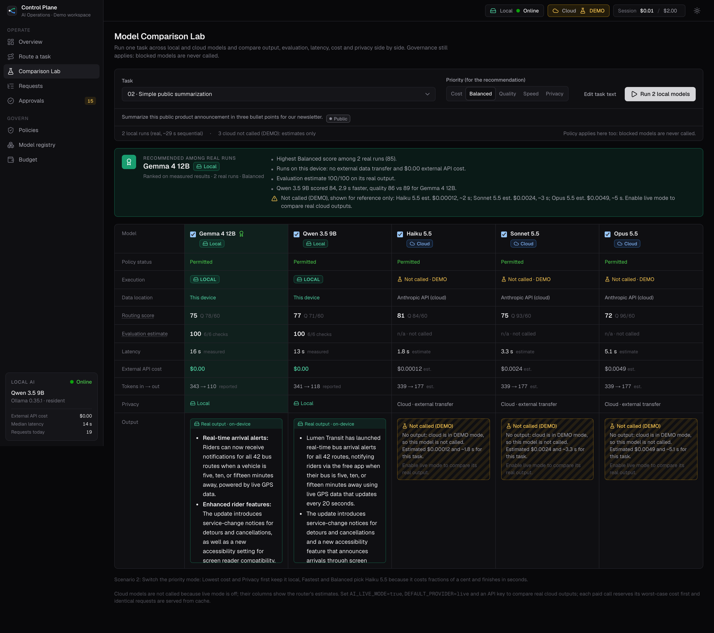
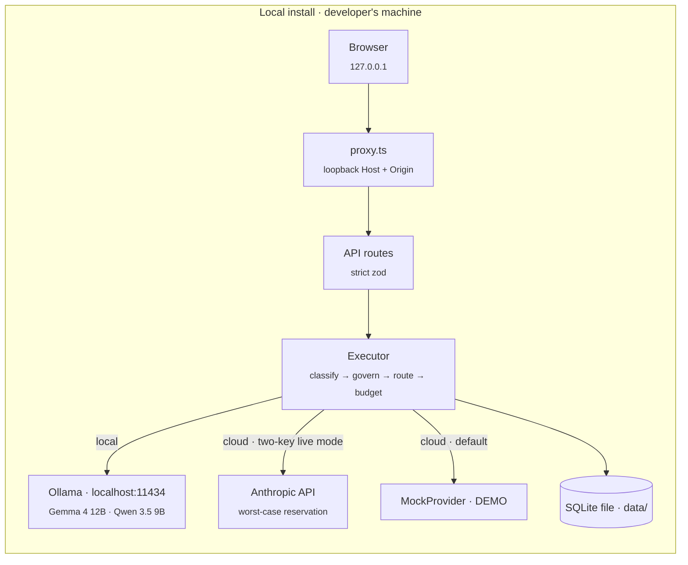
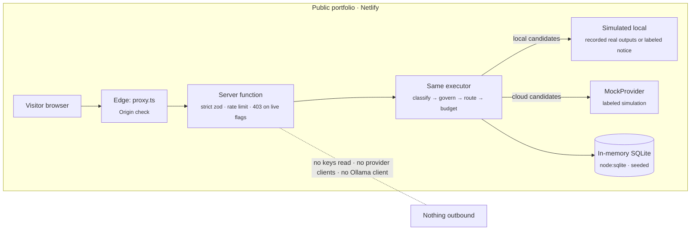

# AI Operations Control Plane

**Decides, per request, whether AI work runs on a model on this laptop or on Claude in the cloud, enforces data policy, caps spend, and fails closed.**

Not every AI task should go to the most powerful cloud model. Confidential work can stay on a local model at zero API cost; complex reasoning can justify a stronger cloud model; simple work shouldn't pay for intelligence it doesn't need. This project is the layer that makes that call for every request, explains it, and records it.

**Engineering decisions worth a look**

- **Fail closed.** If policy requires local execution and the local model is down, the request is blocked. Restricted data never falls back to the cloud, and fallback chains only contain models that already passed governance.
- **Worst-case budget reservation.** Before a paid call, input + `max_tokens` at list price is reserved in the ledger synchronously, so concurrent requests can't overspend; actual usage is reconciled afterwards.
- **No silent model swaps.** SDK retries are off and Anthropic's server-side fallback is deliberately unused: a substitution the control plane didn't choose would bypass governance and cost accounting.
- **Free isn't automatically best.** Quality above a task's requirement counts at a reduced rate, so a $0.0002, 2-second cloud call can beat a 20-second local run for public data, while confidential data stays local regardless.
- **Honest modes.** Every answer is labeled LOCAL (real on-device inference), LIVE API (real paid call) or DEMO (simulated, never recommended, never counted as spend).

**Proof:** 170 automated tests (core, providers over mocked HTTP, services on in-memory SQLite, portfolio-mode guarantees); tests cannot reach paid APIs. Local inference was exercised for real on an M3 Pro: 24 runs through the app on Gemma 4 12B and Qwen 3.5 9B, averaging 18 s at ~17 tok/s, $0.00 API cost. Paid API spend during development: $0.00 (no API key was configured; cloud ran in DEMO mode).



| | |
|---|---|
| **Local AI** | Real inference through [Ollama](https://ollama.com) on the developer's laptop (Gemma 4 12B and Qwen 3.5 9B on an M3 Pro). Any installed Ollama model is discovered and registered automatically. |
| **Cloud AI** | Anthropic Claude Haiku 5.5, Sonnet 5.5 and Opus 5.5 through the official SDK. OpenAI and Gemini adapters are included and activate when configured. |
| **Default mode** | DEMO: local models run for real, cloud models are simulated by `MockProvider` and labeled as such. Paid calls are opt-in. |
| **Public demo** | A separate [portfolio mode](#public-portfolio-demo): same routing and governance, simulated execution, no keys, no access to any machine. |

## What it does

For every request the control plane:

1. **Classifies the task** (type, complexity, business risk) with deterministic, explainable rules.
2. **Scans for sensitive data** (emails, phone numbers, government IDs, payment cards, credentials, health and compensation data, confidentiality markings) and sets the data classification. A declared label can raise the level, never lower it.
3. **Applies governance policy** to every registered model: which models may receive this data at all.
4. **Checks availability**: is Ollama up, which model is resident in memory, is the cloud provider configured.
5. **Scores every eligible model** on privacy, cost, task fit, reasoning and latency, weighted by the chosen priority mode, after a quality threshold that depends on complexity.
6. **Guards the budget**: reserves the worst-case cost before any paid call and reroutes to a capable local model when cloud doesn't fit.
7. **Executes** with a pre-approved fallback chain, never retrying the same model.
8. **Evaluates** the output, **holds it for human review** when policy requires, and **records a full trace**.



## The three screens

| AI Operations Overview | Routing decision | Model Comparison Lab |
|---|---|---|
|  |  |  |
| Local vs cloud volume, external API spend vs spend avoided, evaluation, human reviews, policy blocks, live Local AI status and routing distribution. | Request → classifier → policy gate, then the local lane and cloud lane, every model's factor scores, why the winner won and why the others didn't. | One task across local and cloud models: output, evaluation, latency, external API cost, tokens, privacy and data location side by side, with a recommendation. |

More: [fail-closed block](docs/screenshots/04-fail-closed.png) · [budget guard](docs/screenshots/05-budget-guard.png) · [Sonnet over Opus](docs/screenshots/06-sonnet-over-opus.png) · [request trace](docs/screenshots/07-request-trace.png) · [governance policy](docs/screenshots/08-governance.png)

## Demo scenarios

All six run from **Route a task**. Organizations, people, emails (`.example`) and phone numbers (555-01xx) are fictional.

| # | Scenario | What happens | Why |
|---|---|---|---|
| 1 | Confidential client brief | **Gemma 4 12B (local)** runs it for real. Haiku, Sonnet and Opus are blocked by policy. External API cost **$0.00**. Held for human review. | Six sensitivity findings make it Confidential. Policy prefers local; cloud needs explicit, justified permission. Qwen 3.5 9B is considered but falls just below the quality bar (67 < 68). |
| 2 | Simple public summarization | Depends on the priority mode: **Lowest cost / Privacy first → local**; **Balanced / Fastest → Haiku 5.5**; **Best quality → Opus 5.5**. | For public data, Haiku costs ~$0.0002 and answers in ~2 s, versus 15–30 s locally. Free isn't automatically best. |
| 3 | Complex strategic reasoning | **Sonnet 5.5** selected. Local models and Haiku are considered but below the reasoning threshold. Opus scores higher on quality but loses on value. | Very high complexity raises the bar to 85. Quality above the requirement counts at 35% in Balanced mode, so Opus's extra capability doesn't justify ~2× the cost. Best quality mode picks Opus. |
| 4 | Cloud provider failure | Haiku is selected, the (simulated) Anthropic API returns 503, the other Anthropic models are skipped as a provider-level failure, and a **local model serves the request**. All of it is in the trace. | Fallback walks a chain built only from models that already passed governance. |
| 5 | Cloud budget exhausted | Team default is Best quality, so **Opus** is selected, but the session has $0.005 left. **Budget Guard** reroutes to a capable **local** model. | The guard reserves the worst case (input + `max_tokens` at list price), not the expected cost. |
| 6 | Restricted data, local AI offline | **Blocked, fail-closed.** "Local execution required by policy, but the approved local provider is unavailable." Nothing is sent to the cloud. | Restricted data is local-only. When the local provider is down, the correct answer is no answer. |

Scenarios 4–6 use fault injection (provider outage, session spend, Ollama offline). Every injected condition is recorded in the trace and marked **simulated**.

## Routing algorithm

The router lives in [`src/core/routing/engine.ts`](src/core/routing/engine.ts); every number it uses is in [`src/core/routing/config.ts`](src/core/routing/config.ts).

**1. Hard gates, in order:** disabled in the registry → blocked by policy → provider unavailable → context window too small. A gated model gets no score.

**2. Quality threshold.** Each model's quality for the task blends its *task fit* (the capability dimensions the task type draws on) with its *reasoning* profile; reasoning's share grows with complexity (15% → 65%). The required quality also grows with complexity: 60 / 68 / 78 / 85. Models below it are "eligible but below threshold" and are only used if nothing else qualifies, in which case human review is required.

**3. Weighted score (0–100)** over five factors:

| Factor | How it's scored |
|---|---|
| Privacy | 100 local. Cloud: 85 public, 55 internal, 25 confidential (with permission). |
| Cost | Square-root scale: 100 at $0, 0 at ≥ $0.05 per request. Small spends still register. |
| Task fit / Reasoning | From the model's Configurable Capability Profile. Quality *above* the requirement counts at a reduced rate (diminishing returns). |
| Latency | Estimated from token counts and throughput (measured from real runs when available), including a cold-start penalty when a local model isn't resident in memory. −18 points per doubling after 1 s. |

| Priority mode | Quality | Cost | Latency | Privacy | Surplus quality counts at |
|---|---|---|---|---|---|
| Lowest cost | 0.20 | 0.70 | 0 | 0.10 | 20% |
| Balanced | 0.40 | 0.25 | 0.15 | 0.20 | 35% |
| Best quality | 0.75 | 0.05 | 0.10 | 0.10 | 100% |
| Fastest | 0.20 | 0.10 | 0.60 | 0.10 | 20% |
| Privacy first | 0.25 | 0.10 | 0.05 | 0.60 | 35%, and a local model that clears the bar always wins |

Scores within 0.5 are ties, broken by lower cost, then lower latency.

**4. Budget guard.** If the winner is a cloud model whose worst-case cost doesn't fit the remaining session or lifetime budget, it is marked over budget and the request goes to the best capable local model; failing that, the cheapest capable cloud model that fits; failing that, it is blocked.

**5. Fallback chain.** The remaining candidates that passed every gate, in rank order. Local-preferring policies keep local alternatives first.

> **Configurable Capability Profiles are routing configuration, not benchmarks.** They express how much an operator trusts a model for a kind of work. The defaults for the two installed local models come from the owner's own local evaluation (2026-10-04, thinking off): Gemma 4 12B passed all graded prompts and a 10K-token retrieval test; Qwen 3.5 9B missed an arithmetic step, a word limit and a long-context lookup but generates ~30% faster. Cloud defaults are tier-based judgment. All values are editable in the Model registry and meant to be tuned with Comparison Lab results.

## Governance

| Classification | Default rule | Human review |
|---|---|---|
| Public | Local or any configured cloud provider | Only if other rules fire |
| Internal | Local or an approved cloud provider (Anthropic) | Only if other rules fire |
| Confidential | Prefer local; cloud only with an explicit permission *and* a written justification, which is recorded in the trace | Always |
| Restricted | Local only | Always |

Policy is editable on the **Policies** page, which also shows a live "who may process what" matrix computed by the same function the router uses. Some guardrails are enforced in code and can't be relaxed there:

- **Fail closed.** If policy requires local and the local provider is down, the request is blocked.
- **No cross-boundary fallback.** Fallback chains only contain models that passed governance for that request.
- **Classification only goes up.** A declared label can raise the detected level, never lower it.
- **Restricted stays local** and is always reviewed.
- **Credentials escalate.** Detected API keys, tokens and private keys make a request Restricted and are redacted from traces.

Human review is also triggered by high business risk (customer-facing, legal, regulated or press audiences), an evaluation estimate below 70, or a missed quality threshold. Reviewers approve or reject in **Approvals**; the decision and note are appended to the request's trace.

## Execution modes: DEMO, LOCAL, LIVE API

The interface always shows which one produced an answer.

| Badge | Meaning |
|---|---|
| **LOCAL** | Real inference on this device via Ollama. Tokens and timings come from Ollama itself. External API cost is $0.00. |
| **DEMO** | A cloud model was selected, but `MockProvider` answered because live mode is off. Output sits under a hatched "Simulated output" banner; tokens, latency and cost are labeled *estimated*; simulated spend is tracked separately and never added to external API spend. |
| **LIVE API** | A real, paid cloud call. Usage and cost come from the provider's reported tokens at list price. |

Zero API cost is not zero compute cost. The dashboard says *External API cost: $0.00* for local runs, not "free".

## Budget safeguards

Built for a total paid-testing budget of about $10–20:

- **Two-key live mode.** Paid calls need `AI_LIVE_MODE=true` **and** `DEFAULT_PROVIDER=live`, plus an API key. The default is DEMO.
- **Worst-case reservation** against a session budget (`SESSION_BUDGET_USD`, default $2) and a lifetime cap on real spend (`LIFETIME_BUDGET_USD`, default $10).
- **Explicit confirmation**: the UI shows the worst-case cost and needs a second click; the API needs `allowLive: true` per request.
- **Token caps**: `max_tokens` comes from the router's estimate, capped by `LIVE_MAX_OUTPUT_TOKENS`.
- **No uncontrolled retries**: SDK retries are off (`maxRetries: 0`), the same model is never retried, and there are at most 3 attempts per request.
- **Response cache**: identical live requests are answered from cache at $0.
- **Tests can't spend**: unit tests replace the global `fetch` with one that throws, and cloud providers refuse to run under the test runner.
- **LLM-as-judge is off**; evaluation is heuristic and free.
- **No server-side model swaps**: Anthropic's server-side `fallbacks` parameter is deliberately not used, because a silent model substitution would bypass governance and cost accounting. Refusals are surfaced and recorded instead.

## Public Portfolio Demo

The same codebase builds in two modes. The public build is a **portfolio demo**: the classifier, sensitivity scanner, governance policy, routing scores, Budget Guard, fallback chains, review rules and request trace all run for real on every request, but **no model is ever called**. There are no API keys, no route to Ollama or to the developer's machine, and nothing a visitor does can create spend.

| | Local install (private) | Public portfolio demo |
|---|---|---|
| Routing, governance, Budget Guard, trace | Real | Real (same code) |
| Local models | Real inference through Ollama on `localhost` | Simulated with reference profiles; replays of real recorded Gemma 4 12B / Qwen 3.5 9B outputs where one exists for that exact prompt, otherwise an explicit notice |
| Cloud models | DEMO by default; real Anthropic calls with two-key live mode | Simulated (`MockProvider`), labeled, never evaluated or recommended |
| API keys | Server-side, `.env.local` | Never read, even if one is set on the host |
| Storage | SQLite file in `data/` | In-memory SQLite (`node:sqlite`), re-seeded per server instance |
| Policies, models, demo data | Editable | Read-only |
| Network exposure | Binds to `127.0.0.1`, loopback Host allowlist | Public, read-only, rate-limited per IP |

### How portfolio mode is enforced

One function, `getDeploymentCapabilities()` in [`src/config/deployment.ts`](src/config/deployment.ts), decides what the deployment may do, and every layer asks it. It **fails closed**: the deployment is portfolio if *any* signal says so.

1. **Build time.** `next.config.ts` inlines `BUILD_DEPLOYMENT_MODE` into every bundle. Any build on Netlify, Vercel or Cloudflare Pages is portfolio, and so is any `DEPLOYMENT_MODE` other than `local`.
2. **Run time.** The server re-checks for hosting signals (`NETLIFY`, `AWS_LAMBDA_FUNCTION_NAME`, …). A hosted environment can only tighten the mode, never loosen it.
3. **Configuration.** In portfolio mode `loadConfig()` never reads `ANTHROPIC_API_KEY`, `OPENAI_API_KEY` or `GEMINI_API_KEY`, forces live mode off, fixes the demo budgets, and logs any setting it ignored.
4. **Composition.** The server builds no cloud provider clients at all and swaps Ollama for a stub with no URL and no network code.
5. **API.** Request schemas are strict (unknown fields such as `provider`, `model` or `apiKey` are rejected with 400); `allowLive` and `maxLiveCostUsd` are refused with 403 *"Execution unavailable in Portfolio Mode…"*; configuration endpoints return 403; mutations need a matching `Origin`.
6. **Executor.** A second check refuses paid execution even if a route forgot to; pinning Opus still only simulates.
7. **Shared data.** Visitors share each server instance, so only unedited built-in scenarios enter the shared history. Text a visitor types is returned to them alone, approvals store no visitor-written notes, and visitors' simulated spend never moves the shared Budget Guard. Scenario 05 still demonstrates the guard because it sets the session spend explicitly.

`tests/services/portfolio.test.ts` covers this with hostile settings: leaked keys, live flags and a reachable fake Ollama. All six scenarios run with zero Ollama calls and zero paid-provider calls, and direct route calls can't bypass the checks.

### Architecture: local vs public





### Deploying to Netlify

Netlify builds Next.js 16 with its OpenNext-based adapter (Next.js Runtime v5, installed automatically). `netlify build` was run locally against this repository: it produced the server function plus an Edge Function for `proxy.ts`, and the bundle passed `npm run verify:portfolio` under `netlify serve`.

1. Push the repository to GitHub (`.env*` and `data/` are gitignored).
2. In Netlify: **Add new project → Import an existing project**, pick the repo. `netlify.toml` already sets the build command, publish directory, `NODE_VERSION = "24"` and the portfolio variables.
3. Do **not** add any API key. Optionally add `PUBLIC_GITHUB_URL` / `PUBLIC_LINKEDIN_URL` for footer links.
4. Deploy a preview first, then run `npm run verify:portfolio -- https://<preview-url>`; it exits non-zero if any guarantee fails.

Under `netlify serve`, refused requests show as 404 rather than 403: the CLI's local proxy retries static paths on any 403. The verify script accepts any refusal status; on the deployed preview, check that `/api/execute` with `allowLive` returns the 403 JSON message.

**Portfolio environment variables** (all optional; Netlify site settings):

| Variable | Value | Notes |
|---|---|---|
| `DEPLOYMENT_MODE` | `portfolio` | Set in `netlify.toml`. Any Netlify build is portfolio regardless. |
| `AI_LIVE_MODE` / `DEFAULT_PROVIDER` | `false` / `mock` | Set in `netlify.toml`; ignored in portfolio mode anyway. |
| `NODE_VERSION` | `24` | Set in `netlify.toml`. Functions run on the build's Node version; `node:sqlite` needs 22.13+. |
| `PUBLIC_GITHUB_URL`, `PUBLIC_LINKEDIN_URL` | `https://…` | Optional footer links; non-https values are dropped. |
| `ANTHROPIC_API_KEY`, `OPENAI_API_KEY`, `GEMINI_API_KEY` | **never set** | Would be ignored and logged, but keys don't belong on a public site. |

**Preview the public build locally** (separate output folder, so the local build in `.next` is untouched):

```bash
npm run build:portfolio && npm run start:portfolio    # http://127.0.0.1:3001
npm run verify:portfolio -- http://127.0.0.1:3001
```

**Portfolio limitations.** History lives in memory per server instance, so it resets on cold starts and differs between instances; a visitor's own requests stay viewable from their browser session. Recorded local outputs exist only for the built-in scenario and seed prompts; any other prompt gets a labeled notice instead of text. Rate limits are per instance.

## Running it

Requirements: Node.js 22+ (developed on 24), and optionally [Ollama](https://ollama.com) with at least one chat model.

```bash
npm install
cp .env.example .env.local        # optional: defaults are safe (DEMO mode)
npm run dev                       # http://127.0.0.1:3000
```

On first run the app seeds a week of **labeled demo workload** (routed by the real engine, execution simulated) so the dashboard isn't empty. Filter it out with **Real executions**, or run `npm run seed:reset -- --clear`.

**Local models.** With Ollama running, installed models are discovered automatically (`ollama list`). Pull another and it registers on the next request:

```bash
ollama pull llama3.2:3b
```

**Live cloud calls** (optional, paid):

```bash
# .env.local
AI_LIVE_MODE=true
DEFAULT_PROVIDER=live
ANTHROPIC_API_KEY=sk-ant-...
SESSION_BUDGET_USD=0.50
```

Restart the server. The top bar switches from **Cloud · DEMO** to **Cloud · LIVE API**. Set either switch back to disable paid calls.

| Command | |
|---|---|
| `npm test` | Unit and service tests (no network, no paid APIs) |
| `npm run test:ollama` | Optional integration tests against your local Ollama (free, ~1 min) |
| `npm run typecheck` · `npm run lint` · `npm run build` | |
| `npm run seed:reset` | Regenerate the demo workload; real executions are untouched |
| `npm run build:portfolio` · `npm run start:portfolio` | Build and serve the public portfolio variant on port 3001 |
| `npm run verify:portfolio -- <url>` | Check a running portfolio deployment from the outside (simulated requests only) |

## Architecture

A modular monolith. Business logic has no framework imports, so it is unit-tested directly; React components only render.

```
src/
  core/                    pure TypeScript: no I/O, no framework
    classification/        task type, complexity, business risk
    security/              sensitivity scanner, redaction, classification order
    governance/            policy, per-model policy evaluation, human-review rules
    routing/               gates, scoring, selection, budget guard, fallback chain
    pricing/ budget/       token estimates, list-price cost, worst-case reservation
    evaluation/            heuristic output checks, comparison recommendation
    models/                cloud catalog, local family profiles
  providers/               one AIProvider interface for all of them
    ollama/ anthropic/ openai/ google/ mock/
  services/                orchestration and persistence (SQLite)
    execution/             plan → execute → fallback → evaluate → review → trace
    observability/         execution log, analytics queries
    approvals/ budget/ registry/ settings/ cache/ seed/
  server/                  composition root (server-only), API schemas, queries
  app/                     Next.js pages and API routes
  components/              UI
tests/                     Vitest: core, providers (mocked HTTP), services (in-memory SQLite)
```

```ts
interface AIProvider {
  readonly id: ProviderId;
  readonly kind: "local" | "cloud" | "simulated";
  execute(request: AIRequest): Promise<AIResponse>;
  health(): Promise<ProviderHealth>;
}
```

Ollama specifics stay inside `providers/ollama`: requests run with thinking disabled (on this hardware thinking turned 10-second answers into multi-minute waits), an explicit `num_ctx`, and `keep_alive`. Load, prompt-eval and generation timings are read from Ollama's response and feed back into the router's latency estimates. Modelfile aliases that share weights (for example `gemma-chat` → `gemma4:12b-it-qat`) are folded into one registry entry.

**Stack:** Next.js 16 (App Router, Cache Components / Partial Prerendering), React 19, TypeScript, Tailwind CSS 4, Radix primitives, better-sqlite3, zod, Vitest, Playwright (screenshots), `@anthropic-ai/sdk`. Charts are hand-built SVG/HTML with a colorblind-validated palette (local = aqua, cloud = blue, policy block = orange; red is reserved for failures).

## Security notes and limitations

What it does:

- API keys are read only on the server (`server-only` composition root); the browser receives a key-free status view.
- Secrets are redacted from traces, logs and stored previews. Inputs are stored as a SHA-256 fingerprint plus a redacted preview, never the raw document.
- Mutating API routes reject cross-origin requests; inputs are validated with zod and size-limited.
- The dev and production servers bind to `127.0.0.1`, and local installs accept only loopback `Host` headers (DNS-rebinding protection).
- The public build is a separate, read-only, simulated mode; see [Public Portfolio Demo](#public-portfolio-demo).

What it doesn't do, honestly:

- **Single operator, no authentication.** The local version is a local tool; exposing *it* on a network would need real auth and authorization. The public portfolio build avoids the need by having nothing to protect: no keys, no models, no editable state.
- **Outputs are stored unencrypted** in the local SQLite database (they are needed for human review). Encryption at rest is not implemented.
- **Classification is rule-based.** Regex and keyword detection will miss sensitive data it has no pattern for, and can over-classify. The default for unlabeled content is Internal, not Public, so errors fail toward caution.
- **The evaluation estimate is a heuristic** (structure, length, grounding overlap, truncation, refusals, echoed contact details). It screens for obvious failures; it does not measure correctness.
- **Capability profiles are configuration**, not benchmarks (see above).
- **Latency for cloud models is estimated** until live runs provide measurements. Simulated cloud results in the Comparison Lab use the capability profile for quality, and the recommendation says so.
- **Token estimates** before execution use ~4 characters per token; executions record provider-reported counts.
- **OpenAI and Gemini adapters** are covered by mocked-HTTP tests but have not been run against the live APIs. Their prices must be configured; none are guessed.
- **Anthropic prices** are list prices from the Claude API reference as cached on 2026-10-06; check current pricing before relying on cost figures.
